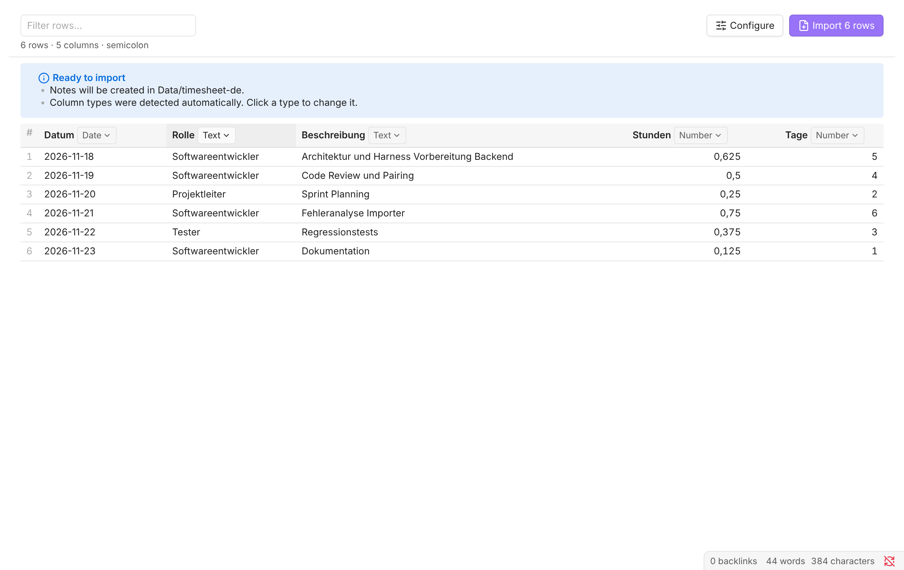
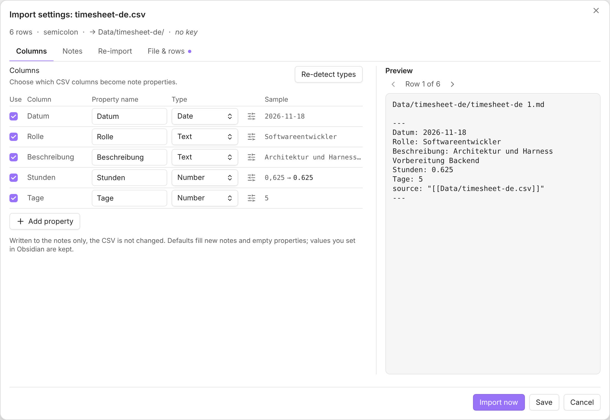
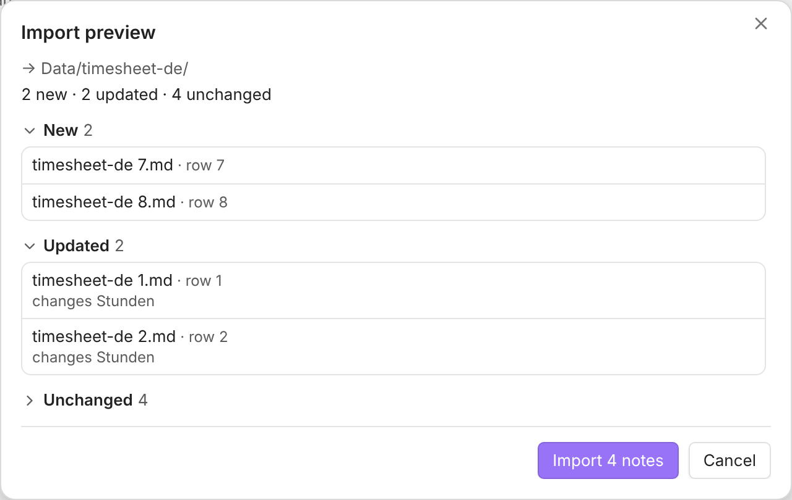
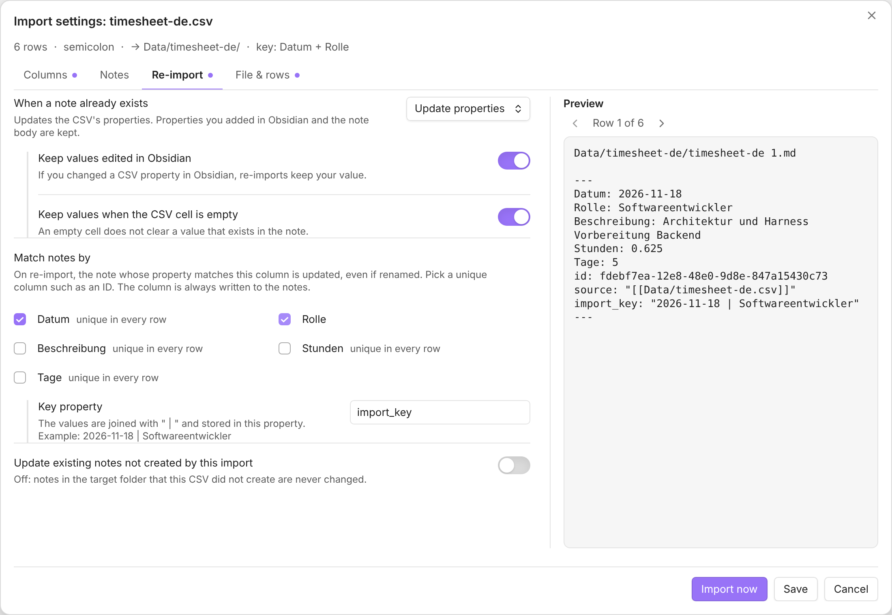
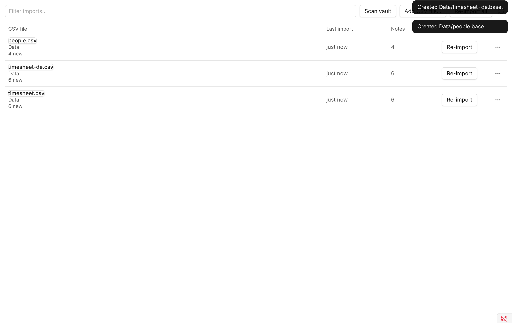

# CSV Importer

Keep a CSV file in your vault, view it as a table, and turn every row into a note with typed properties, so Bases can sum, filter and sort them. When the CSV changes, replace the file and import again: the properties you edited or added in Obsidian are kept. Every import can be previewed first and undone afterwards.

It works with Excel and German exports: semicolon delimiter, decimal comma, Windows-1252 encoding and `DD.MM.YYYY` dates.

| Import settings | Import preview |
| --- | --- |
|  |  |
|  |  |

Screenshots are captured in real Obsidian with the default theme by the end-to-end test suite (`npm run screenshots:readme`). Your theme may look different.

## Quick start

1. Put a CSV file in your vault, for example `Data/timesheet.csv`.
2. Click the file. It opens in a table view with a type badge on every column.
3. Check the column types (click a badge to change it), then select **Import 6 rows** (the count follows your file).
4. Review the preview, then select **Import 6 notes**. The notes appear in `Data/timesheet/`.

Sample files are in [`examples/`](examples).

## Walkthrough: timesheet to Bases

This uses [`examples/timesheet.csv`](examples/timesheet.csv): one row per working day with `Datum`, `Rolle`, `Beschreibung`, `Stunden` and `Tage`.

1. Copy `timesheet.csv` to `Data/timesheet.csv` and open it. `Stunden` and `Tage` show a number badge, `Datum` a date badge.
2. Select **Configure** in the table view. On the **Notes** tab, **Create a base** is on by default. On the **Re-import** tab, tick a column under **Match notes by** that is unique per row. The sample timesheet has one entry per day, so `Datum` works. Real timesheets often have several entries per day: tick two columns (for example `Datum` and `Rolle`) for a composite key, or add an ID column to the export. Without a key, notes are matched by file name (for example `{{Datum}} {{Rolle}}`). Select **Import now** (it also saves; **Save** only saves).
3. Review the preview and import. You get one note per row, and a `.base` file next to the folder that lists them as a table.
4. Open the base. In the table view, use the column menu of `Stunden` to add a summary and choose **Sum**. This works because `Stunden` is a real number in every note, not text. (Menu names depend on your Obsidian version.)
5. Add a property `Abgerechnet` (checkbox) to a few notes, or add the column in the base.
6. Edit `Data/timesheet.csv` outside Obsidian, or replace the file with a version where some `Stunden` values changed, keeping the same name and path.
7. Select **Re-import** in the CSV imports index, or **Import 6 rows** in the table view. The preview lists the notes that will be updated and which properties change. `Abgerechnet` is not touched. Select **Import 6 notes**.

The Sum in the base now reflects the new hours, and `Abgerechnet` is still set.

## Import settings

Select **Configure** in the table view (or run **Configure import for current CSV file**, or use **Configure CSV import** in the file menu) to open the import settings. The title shows the file name, and a summary line under it (rows, delimiter, target folder, key, filter) links to the matching tab. The preview of a note is next to the settings on wide screens and behind a **Preview** button on narrow ones. A dot on a tab means it has settings that differ from the defaults.

| Tab | What is on it |
| --- | --- |
| **Columns** | Per column: use, property name, type, sample. **Re-detect types**. **Extra properties**. |
| **Notes** | Target folder, file name template, body template, tags, **Link notes to the CSV**, **Create a base**. |
| **Re-import** | **When a note already exists** (with its options), **Match notes by**, **Update existing notes not created by this import**. |
| **File & rows** | Encoding, delimiter, header row, decimal separator, date order, list separator, empty cells, number precision, **Filter rows**. |

Buttons at the bottom: **Import now** (saves, then opens the import preview), **Save** and **Cancel**.

The **Options** button on a column row (**Show options** / **Hide options** as its tooltip) opens a **Value template** field and, for number columns, **Ignore units (€, $, %)**.

## Table view

Clicking a `.csv` file opens it as a table. Each column header shows a type badge (Text, Number, Yes/no, Date, Date & time, List). Click a badge to:

- change the column's type,
- **Link values ([[…]])** (writes each value as `[[value]]`; the item becomes **Unlink values** once set),
- **Exclude from import** (or **Include in import**).

Above the table: a filter box, **Import settings** (an icon on phones), and one primary button, **Import 6 rows**. A status line shows rows, columns, delimiter, extra properties, when the file was last imported and **Undo** (undoes the last import). At most one callout is shown at a time: a read error, changed columns (with **Review columns**), or a note for the first import. Its title names the problem, for example **Columns changed**; when unrelated problems are listed together it says how many there are (**2 things to check**). If a row filter is set, the callout says how many rows will be imported. Long tables are shown in pages; **Show more** appends rows.

Tick rows to import only those: the header checkbox selects every row that matches the filter, shift-click selects a range, and the primary button becomes **Import 2 selected rows**. **Clear selection** in the status line drops the selection. The view's more-options menu (⋮) has **Import settings** and **Open CSV imports**.

## Typed properties

Obsidian Bases and Dataview can only sum, average, sort or filter a property if the value in the note's YAML has the right type. CSV Importer writes typed values:

- Numbers unquoted, with decimal comma and thousands separators normalized (`0,5` becomes `0.5`) and no floating-point noise. Optional rounding via **Number precision**.
- Dates as `YYYY-MM-DD`, datetimes as `YYYY-MM-DDTHH:mm:ss`, unquoted. Source formats are listed under [Date formats and units](#date-formats-and-units); Excel serial numbers are converted for columns typed date.
- Booleans as `true` / `false`.
- Text quoted only when YAML requires it, including text that would otherwise read as a number, date or boolean (`id: "007"`).
- Empty cells as an empty property or omitted, never `""`.
- One type per column, so every note has the same type for the same property.

A column's type is inferred from all its non-empty values. A type is chosen only if every value fits; otherwise the column is text.

| Type | Recognized values | Example |
| --- | --- | --- |
| checkbox | `true` / `false`, `yes` / `no` (case-insensitive) | `true` |
| number | integers and decimals; decimal comma when the decimal separator is `,` | `0.625`, `0,625` |
| date | the formats under [Date formats and units](#date-formats-and-units), or datetimes at midnight (setting: Treat midnight timestamps as dates) | `2026-11-18`, `18.11.2026` |
| datetime | datetimes with a time component | `2026-11-18 14:30:00` |
| list | never inferred; choose it per column. Values are split by the list separator | `a, b, c` |
| text | everything else | `Backend` |

Values that look like numbers but are identifiers stay text: leading zeros (`007`), phone numbers (`+49…`), very long digit strings, and exponent notation (`1e5`). A column that contains only `no` is text, not a checkbox.

Because the values themselves are typed, Obsidian recognizes the property types from the notes. The plugin does not edit Obsidian's property type settings. If you set a different type for a property in Obsidian yourself, the editor follows your setting, but the stored values stay typed.

## Value templates

Each column can have a value template applied after type conversion. `{{value}}` (or `$value`) is the cell value; `{{Other column}}`, `{{row}}` and `{{file}}` work too.

| Template | Cell | Property |
| --- | --- | --- |
| `[[{{value}}]]` | `Softwareentwickler` | `Rolle: "[[Softwareentwickler]]"` |
| `{{value}} h` | `0,5` | `Stunden: 0.5 h` (text) |

For list columns the template is applied to every item, so `[[{{value}}]]` creates a list of links. Empty cells stay empty. Set a template under **Options** > **Value template** on the **Columns** tab, or use **Link values ([[…]])** in the badge menu of the table to set `[[{{value}}]]` in one click.

## Extra properties and IDs

On the **Columns** tab of the import settings, **Extra properties** adds properties to the imported notes that are not columns of the CSV, for example `status: open` for every new note. Extra properties are written only to the notes: the CSV file is never changed.

Each extra property has a name, a type and a default value. The default value can use:

| Placeholder | Replaced with |
| --- | --- |
| `{{Column}}`, `{{row}}`, `{{file}}` | the same values as in other templates |
| `{{today}}` | today's date, `YYYY-MM-DD` |
| `{{now}}` | the current date and time, `YYYY-MM-DDTHH:mm:ss` |
| `{{uuid}}` | a new random ID (UUID) per note |

The default only fills in. It is written when a note is created, and on re-import only if the property is missing or empty, so a value you set in Bases (for example `status: done`) is never overwritten. If an extra property has the same name as a CSV column, the column wins and you get a warning.

**Add property** opens a menu: **Empty property**, or **ID (unique per note)**, which adds an `id` property with the default `{{uuid}}`. You can rename it. Every new note gets its own UUID, and the ID stays the same on re-imports. Because the ID exists only in the notes, it can't be used to match rows on re-import. Use a key column from the CSV for that.

## Templates and folders

Templates are used for the note file name, the note body and the target folder.

| Placeholder | Replaced with |
| --- | --- |
| `{{Column}}` | the value of the column with that header |
| `{{row}}` | the 1-based data row number |
| `{{file}}` | the CSV file name without extension |

Example file name template: `{{Datum}} {{Rolle}}`. Typed values are formatted in file names (`2026-11-18 00:00:00` becomes `2026-11-18`). Characters that are not allowed in file names are removed, and names that Windows reserves (such as `CON`) get a `_` prefix. Long names are shortened to fit the file system.

The target folder accepts the same placeholders, for example `Projects/{{Client}}` creates one folder per client. An empty target folder means a folder next to the CSV named like the CSV (`Data/hours.csv` imports into `Data/hours/`). A folder containing `..` is rejected.

## Existing notes

Choose what happens when a row's note already exists (**When a note already exists** on the **Re-import** tab, per file):

| Option | Behavior |
| --- | --- |
| **Update properties** (default) | Updates only the CSV's own properties. Properties you added in Obsidian and the note body are kept. Notes whose values did not change are not rewritten. |
| **Skip** | Leaves existing notes untouched. |
| **Create a copy** | Creates a new note such as `Name 1.md`. |
| **Replace whole note** | Replaces frontmatter and body. Properties added in Obsidian and the body are lost. You are asked to confirm. |

With **Update properties** two more options apply:

- **Keep values edited in Obsidian** (on by default): if you changed a CSV property in a note, re-imports keep your value. The plugin remembers the last imported value per note and property, so it can tell your edits from changes in the CSV.
- **Keep values when the CSV cell is empty** (on by default): an empty cell never clears a value in the note.

Notes that were not created by this import are never changed. A note counts as created by this import if the plugin has import state for it or if its source link points to this CSV. Any other note, for example an unrelated note with the same name, is skipped with the reason "not created by this import". To change that, turn on **Update existing notes not created by this import** on the **Re-import** tab.

## Matching notes on re-import

Notes are matched in one of two ways:

- **Match notes by** (recommended): on the **Re-import** tab, tick the columns that identify a row, such as an ID. Notes in the target folder whose key property matches are updated, even if you renamed or moved them within that folder. A single key column is always written to the notes, even if you excluded it, because it has to be stored to find the note again. The plugin suggests a column marked "unique in every row" when no key is set (**Use** button); long free-text columns are never suggested.
- **Composite key**: tick two or more columns (for example `Datum` and `Rolle`). Their values are joined with ` | ` and stored in one **Key property** (default `import_key`), with an example shown under it. The individual columns follow their own **Use** setting. A row where any key column is empty gets no key.
- **File name**: without a key column, notes with the same generated file name are updated. If you insert or re-sort rows, or change the file name template, notes no longer line up and you get wrong updates or duplicates. The preview warns when no key is set, and when the CSV has duplicate keys or the vault has duplicate notes for a key (for example sync conflict copies).

If the CSV has a column named `source`, the source link is written to `source_csv` instead so the column is not overwritten.

## Row filter

On the **File & rows** tab, **Filter rows** limits the import to rows where one column meets a condition: **Import rows where** a column *equals*, *does not equal*, *contains*, *does not contain*, *is empty*, *is not empty*, *is greater than* or *is less than* a value. Text comparisons ignore case; numbers are compared as numbers when both sides parse. The preview, the import button count and the table view follow the filter. Rows that do not match are not imported and existing notes for them are left alone. There is one condition per file.

## Date formats and units

Dates are read from `YYYY-MM-DD`, `YYYY/MM/DD`, `DD.MM.YYYY`, `DD-MM-YYYY`, `DD/MM/YYYY`, `MM/DD/YYYY` and month names in English and German (`18 Nov 2026`, `November 18, 2026`, `18. März 2026`), optionally followed by a time. Slash dates such as `03/04/2026` are ambiguous. With **Date order for dates like 03/04/2026** on **Detect (only when unambiguous)**, the order is taken from the column (a value like `25/03/2026` or `03/25/2026` settles it); otherwise the column stays text and is never guessed. Choose **Day first (DD/MM/YYYY)** or **Month first (MM/DD/YYYY)** to decide it yourself.

For number columns, **Ignore units (€, $, %)** under the column's **Options** strips currency symbols and codes, percent signs and space or narrow-space thousands separators before parsing: `1.234,56 €`, `$1,234.56`, `12 %`. The unit is dropped, not stored. Units that are not currency or percent, such as `kg`, are not recognized as units.

## Import dialog

Importing first shows **Import preview** without writing anything. It starts with one sentence, such as "4 notes will be written to Data/timesheet/. 3 rows need attention.", then one line of counts (`2 new · 2 updated · 1 unchanged · 2 skipped · 1 failed`) and results grouped as **Failed**, **Skipped**, **New**, **Updated** and **Unchanged**, with paths relative to the target folder and the changed properties per note. Uncheck notes under **New** or **Updated** to leave them out of this run. Warnings (parser, no key, duplicate keys, large imports, active row filter, extra properties that clash with columns) are shown in a callout whose title names the problem, for example **Notes are matched by file name**, or **2 things to check** when there are several kinds. Select **Import 4 notes** to write them. You then see progress with **Stop import**, and the title changes to **Import finished** ("4 notes written to Data/timesheet/.") with these buttons:

- **Open base** (the primary button) when the import has a base; otherwise **Open first note**. Both close the dialog.
- **Close**.
- **...** (**More actions**): **Open first note** (when **Open base** is the primary button), **Save report as note**, and **Undo last import**.

**Undo last import** (also **Undo** in the table view, the command **Undo last import of current CSV file**, **Undo last CSV import** in the file menu, and **Undo last import** in the index) moves notes created by the import to the trash and restores the previous content of notes it modified. Notes you changed after the import are skipped and listed.

The command **Re-import all configured CSV files** opens the import dialog for each CSV that has saved settings, one after the other.

## CSV imports index

The ribbon icon **Open CSV imports** (or the command of the same name, or the button in the plugin's settings) opens an index of every CSV file with saved import settings. It opens in its own tab; opening it again reveals the existing one. Files are sorted by last import, newest first, then by name.

Each row shows the CSV (click to open it in the table view), its folder, when it was last imported (or "Never imported"), and how many notes this import owns. A missing file is marked **CSV missing**. Actions per row:

- **Import** (never imported) or **Re-import**: runs the normal import dialog.
- **Configure** (icon button): opens the import settings.
- **...** menu: **Configure**, **Open base** (if a base exists), **Undo last import** (when an undo is available), then **Delete imported notes...** and **Remove from index...**.

Under the name, the row also shows the result of the last import ("12 new · 5 updated · 120 unchanged · 2 skipped"; imports from before this was recorded show only the note count) and, when you edited some notes in Obsidian since, "N edited since import". Hover it to see which properties differ. A note counts as edited when a property the import manages no longer has the value the import wrote.

**Changed CSV files.** After each import the plugin remembers the CSV's size, modification time and a hash of its content. When the file differs (it is compared by size and modification time first, and read only when those differ), the row gets a **Changed** badge with how long ago it changed, **Re-import** becomes the highlighted button, and a line at the top says "N CSV files changed since their last import" with a **Re-import changed** button that runs the import dialog for each one after the other. The list updates by itself when a CSV is modified, renamed or deleted. A file that was only saved again with the same content is not marked. An import from before this was recorded counts as changed until you import it once more. The table view's status line shows the same state.

**Scan vault** lists every CSV file in the vault that is not in the index yet, with its folder, size and number of rows. All are checked; uncheck what you do not want and choose **Add to index**. The files get default import settings and nothing is imported. Scan again later and only new files are listed.

**Add CSV file...** copies a CSV from anywhere on your device into the vault. Choose the file with the system file picker (it works on desktop and mobile), the folder in the vault and the file name. If a file of that name already exists you choose **Replace the existing file** or **Keep both** (the new file gets a free name such as `name 1.csv`). The bytes are copied unchanged. The file is then added to the index and opened in the table view. The plugin cannot follow the original file: to update the copy, add the file again with the same folder and name and choose Replace; the index then shows it as changed.

At the top: a filter box, **Scan vault**, **Add CSV file...**, **Re-import all**, and a refresh button. **Re-import all** runs the import dialog for every listed CSV that still exists. With no entries, the view shows "No imports yet" and how to set one up.

**Delete imported notes...** moves the notes this import owns to the trash (using your Obsidian trash setting) after a confirmation that states the count. A note counts as owned when the import history lists it and it still exists as a Markdown note, even if you renamed or moved it. Notes you created yourself, even in the same folder, are never touched. A checkbox, **Also delete the base file**, also trashes the base. Afterwards the import history and undo data are cleared and "last import" is reset, but the CSV's settings stay, so you can import again. This works even when the CSV file is missing. It does not use the undo data, so it cannot be undone from the plugin; restore from Obsidian's trash instead.

**Remove from index...** deletes the CSV's settings and import history after a confirmation. Imported notes stay.

## Encoding

The encoding is detected automatically: byte order mark, then UTF-8, and Windows-1252 as the fallback (typical for Excel "CSV" exports). UTF-16 files with a BOM are supported. You can also set the encoding by hand per file.

## Settings reference

**Settings > CSV Importer** holds defaults for CSV files you have not configured yet. Once you save a file's import settings, that file keeps its own values. The settings are searchable in Obsidian's settings search.

**Reading files**

- Encoding, Delimiter, First row contains column names, Decimal separator, List separator
- Empty cells (leave property empty or omit it)
- Treat midnight timestamps as dates

**New notes**

- Target folder (empty: folder named like the CSV)
- File name template, Body template, Comma-separated tags
- Link notes to the CSV
- Create a base

**Re-import**

- When a note already exists: Update properties, Skip, Create a copy, Replace whole note
- Keep values edited in Obsidian
- Keep values when the CSV cell is empty

**Table view**

- Rows shown per page

**Imports**

- **Open CSV imports** opens the index.

**Danger zone**

- **Reset all import settings...** removes the saved import settings of every CSV file. Imported notes are not affected.

Per file only (import settings, not in the settings tab): column types, property names and value templates, ignore units, extra properties, match notes by and key property, Update existing notes not created by this import, date order, number precision and Filter rows.

`tags`, `aliases` and `cssclasses` columns are always written as lists.

## Privacy and data

- CSV Importer makes no network requests and collects no telemetry.
- Settings, including per-file import settings, are stored in `.obsidian/plugins/csv-importer/data.json`.
- Import state and undo data are stored in `.obsidian/plugins/csv-importer/imports/`:
  - `index.json`: which CSV files have import state, and whether they can be undone.
  - `<hash>.json`: per CSV, a hash of the last imported value per note and property, used to protect your edits and to know which notes an import owns.
  - `<hash>.undo.json`: per CSV, the previous content of the notes the last import changed.

  `<hash>` is derived from the CSV's path. The undo files can contain row data. If you sync your vault's configuration folder, these files are synced too.
- The CSV file is never modified.
- **Add CSV file...** opens the system file picker. Only a file you choose there is read, only when you choose it, and it is copied into the vault (the folder and name you set). The plugin does not follow, watch or read the original again, and accesses no other files outside the vault.
- Per CSV, `imports/index.json` also holds the CSV's size, modification time, a content hash (to show that the file changed since the last import) and the counts of the last import. No row content is stored there.
- Files the plugin creates: the notes, an optional `.base` file, and an optional import report note.
- It uses only Obsidian's documented plugin API. It does not write `.obsidian/types.json`: because values are written as typed YAML, Obsidian picks up the property types from the notes.

## Limitations

- Import is one-way, from the CSV to notes. Changes in notes are not written back to the CSV.
- Rows removed from the CSV leave their notes in place.
- Renaming a column in the CSV needs re-mapping in the import settings.
- Time zones are dropped from datetimes.
- Undo covers only the last import of a file. Very large imports may not be fully undoable because the stored undo data is capped; you get a warning when that happens.
- One row filter condition per file.
- Column types are inferred from all rows, so very large files take longer to open.

## Troubleshooting

**Numbers are imported as text.**
Check **Decimal separator** on the **File & rows** tab: `0,625` needs a comma. A single non-numeric value in a column makes it text. Fix the value or set the column type to Number. For values such as `12,50 €` or `12 %`, turn on **Ignore units (€, $, %)** under the column's **Options**.

**Nothing happens when I click a CSV file.**
Another plugin probably handles `.csv` files. Obsidian lets only one plugin register an extension. Disable the other plugin's CSV view, or use the commands and file-menu entries of CSV Importer, which work without the table view.

**I got duplicate notes after changing the file name template.**
Without a key, notes are matched by file name. Tick a key under **Match notes by** on the **Re-import** tab, then import again. Remove the duplicates by hand or with **Undo import** if it was the last run.

**Characters look garbled.**
The encoding was detected wrongly. Set **Encoding** on the **File & rows** tab (Windows-1252 for most Excel exports).

**Rows are skipped with "not created by this import".**
A note with that name or key already exists but this CSV did not create it. Rename or move that note, or turn on **Update existing notes not created by this import**.

**Dates are not recognized.**
Slash dates like `03/04/2026` are ambiguous and the column stays text unless another value settles the order. Set **Date order for dates like 03/04/2026** on the **File & rows** tab. Excel serial numbers are inferred as numbers; set the column type to Date to convert them.

## FAQ

**Does it change my CSV?**
No. The plugin only reads CSV files.

**A property shows the wrong type in Obsidian.**
If the property already has a different type in your vault, Obsidian keeps showing that type, because CSV Importer does not change Obsidian's property types. Change the type in Obsidian's properties view.

**Can I import only some rows?**
Yes: use **Filter rows** on the **File & rows** tab. Exclude columns with the badge menu in the table view.

**Do I lose my notes if I choose Delete imported notes?**
They go to Obsidian's trash, so you can restore them there. Only notes this import owns are moved.

**Does it keep the notes in sync automatically?**
No. You run the import. There is no automatic re-import when the file changes.

## How it compares

Competitor facts are taken from the plugins' own documentation and listings as read on 2026-11-23 and may have changed since. See [`docs/RESEARCH.md`](docs/RESEARCH.md) for sources.

| | CSV Importer | Importer (official), CSV format | Bases Data Studio |
| --- | --- | --- | --- |
| Focus | CSV only | Many formats, including CSV | Importing data into Bases |
| Typed property values | One type per column, written as typed YAML | Per its documentation, column values become properties | See its listing |
| Table view of the CSV | Yes | No | See its listing |
| Preview before writing | Yes | No | Yes, with key matching |
| Re-import without losing edits | Per property, edits and added properties kept | Skips notes modified in Obsidian (whole note) | Key matching |
| Undo | Last import | Not documented | Tells users to back up the vault |
| Excel and German exports | Delimiter, decimal comma, encoding detection | See its documentation | See its listing |
| Base file | Optional, generated | Optional, generated | Native focus |

## Installation

Requires Obsidian 1.15.1 or later (desktop and mobile).

### Community plugins

Once CSV Importer is listed in the community store:

1. Open **Settings > Community plugins** and turn off restricted mode.
2. Select **Browse**, search for **CSV Importer**, then **Install** and **Enable**.

### BRAT

1. Install the [BRAT](https://github.com/TfTHacker/obsidian42-brat) plugin.
2. Run **BRAT: Add a beta plugin for testing** and enter `luis85/obsidian-csv-importer`.
3. BRAT installs the latest GitHub release and keeps it updated.

### Manual

1. Download `main.js`, `manifest.json` and `styles.css` from the [latest release](https://github.com/luis85/obsidian-csv-importer/releases/latest).
2. Copy them to `<vault>/.obsidian/plugins/csv-importer/`.
3. Reload Obsidian and enable **CSV Importer** under **Settings > Community plugins**.

Developing the plugin? See [CONTRIBUTING.md](CONTRIBUTING.md).

## License

[MIT](LICENSE)
